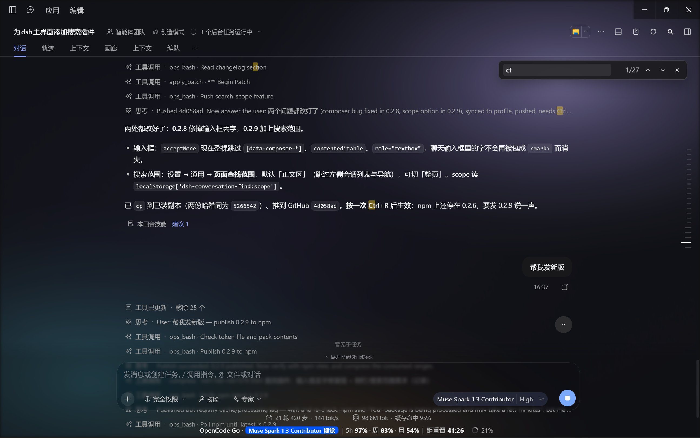
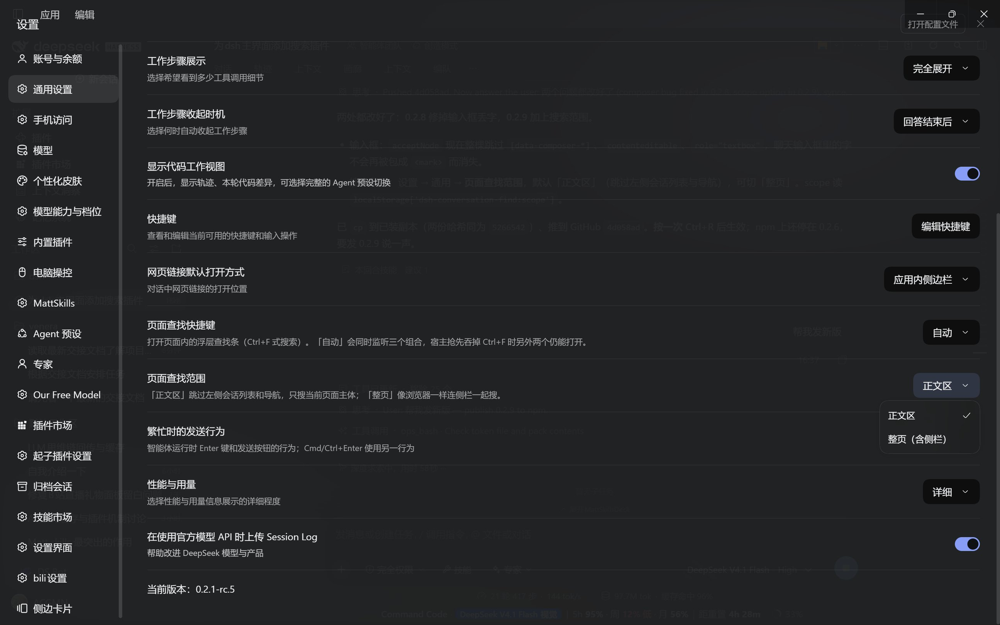

# dsh-conversation-find

[](https://www.npmjs.com/package/dsh-conversation-find)
[](./LICENSE)

<p align="center"></p>

在 DeepSeek Harness 主界面里查找，像浏览器 `Ctrl+F` 一样：搜当前页面文本、全部高亮、逐条跳转。

- **会话页**：只搜当前会话的消息流（含代码块、diff、工具输出），计数干净，不带侧栏和输入框的噪声。
- **其他页面**（设置、插件、插件市场、画布…）：搜整页，等同浏览器自带查找。
- 浮层查找条自动落在头部标签栏的分割线下方，不遮挡标签栏。

## 界面





> 上面两张是桌面端实拍：会话页开着查找条（搜 `ct`，1/27 处命中），以及设置 → 通用里的「页面查找范围」与「页面查找快捷键」。


## 安装

```bash
dsh plugin --profile desktop add dsh-conversation-find
```

或在插件管理里搜索 `dsh-conversation-find` 安装。装完 `Ctrl+R` 刷新一次页面。

本地目录安装（开发用）：

```bash
dsh plugin --profile desktop add file:D:/path/to/dsh-conversation-find
```

## 用法

| 操作 | 键 |
| --- | --- |
| 打开 / 关闭查找条 | `Ctrl+F`（macOS：`Cmd+F`）；「自动」模式同时监听 `Ctrl+Shift+F` 与 `Alt+F` |
| 下一个命中 | `Enter`、`F3` 或 `↓` |
| 上一个命中 | `Shift+Enter`、`Shift+F3` 或 `↑` |
| 关闭 | `Esc` |

会话头部右侧还有一个放大镜按钮，效果相同——宿主的桌面菜单会抢走 `Ctrl+F`，键盘事件到不了页面时用它。

### 快捷键可改

设置 → 通用 → **页面查找快捷键**：

- **自动**（默认）：`Ctrl+F`、`Ctrl+Shift+F`、`Alt+F` 三个组合同时监听。宿主菜单若截走 `Ctrl+F`，页面根本收不到这个按键，另外两个仍然生效——这就是自动降级。
- 固定其一：`Ctrl+F` / `Ctrl+Shift+F` / `Alt+F` / `F3`。

选择存在 `localStorage` 的 `dsh-conversation-find:shortcut`，刷新后仍在。

### 搜索范围可改

设置 → 通用 → **页面查找范围**：

- **正文区**（默认）：会话页只搜消息流；其他页面跳过左侧会话列表与导航，只搜主体内容。
- **整页**：像浏览器一样，把侧栏和页面外壳一起搜。

选择存在 `localStorage` 的 `dsh-conversation-find:scope`。

### 切换页面时

设置 → 通用 → **切换页面时**：

- **关闭查找条**（默认）：换标签页，或从对话打开设置 / 插件市场 / 画布等新页面时，查找条自动收起并清掉高亮。
- **保留查找条**：留在新页面上重新搜一遍同样的词，查找条位置按新页面的布局重新测量。

宿主的页面切换不改 URL，所以判断依据是「搜索根节点换了」；为避免 React 重渲染误判，新根节点要连续两次稳定才算切换。

选择存在 `localStorage` 的 `dsh-conversation-find:on-switch`。

## 行为

- 输入即搜（120ms 防抖），命中全部包一层 `<mark>`，右端显示 `当前/总数`。
- 回车 / `Shift+回车` 在命中之间循环跳转，滚动到视野中央。
- 查找条位置按当前作用域实时测量；窗口缩放、面板开合、页面切换都会重算。
- 会话流式输出、路由切换、React 重渲染后高亮自动重贴（`MutationObserver` + 400ms 抑制窗口 + 250ms 防抖）。
- 查找条自身不参与搜索，已有高亮不会被二次命中。
- 默认跳过输入框、编辑器和左侧会话列表（包 `<mark>` 会让编辑器丢字，见下方已知限制）。

## 已知限制

- 只搜**当前已挂载到 DOM** 的文本。被分页或虚拟化掉的历史不会计入——滚动加载更多后需要重新输入一次。
- 搜的是渲染后的文本，不是原始 markdown 源码。
- **不搜输入框和编辑器里的内容**。把可编辑区域的文字包成 `<mark>` 会让编辑器把这段文字丢掉（输入框里的字会消失），所以 `contenteditable` / `textarea` 一律跳过。
- 暂不支持正则、大小写敏感、整词匹配（当前固定：不区分大小写的子串匹配）。

## 实现

不订阅 chat store，纯 DOM 层：`TreeWalker` 遍历文本节点 → `Range.surroundContents` 包 `<mark>` → `scrollIntoView({ block: 'center' })` 跳转。这样对任何渲染路径（消息、diff、工具卡片、设置页表单）都成立，不依赖内部数据结构。

UI 复用宿主自己的 `@deepseek-ai/dsh-client-ui-primitives`：设置行的下拉就是宿主同款 `Menu`（深色浮层 + 勾选），因此与「应用内侧栏」「繁忙时的发送行为」等行视觉一致；拿不到该模块时自动降级为原生 `<select>`。

```
package.json        # dsh.bundle.patch + dsh.client{inject,platform} + exports["./client"]
cordis.patch.yml    # 只有一条 - insert 行
lib/index.js        # 宿主半边：空实现，让 bundle 行能挂载
lib/client.js       # 全部逻辑：查找条 + 高亮 + 跳转 + 设置行
```

插槽挂载点：

- `shell.overlay`（root）：浮层查找条本体。
- `conversation.session.header.utilities`（session）：会话头部的放大镜按钮。
- `settings.general.item`（root）：快捷键设置行。

## 变更记录

- **0.3.1** 「正文区」在非会话页（设置 / 插件 / 市场）也排除左侧会话侧栏，不再搜到导航条目。
- **0.3.0** 切换页面时默认关闭查找条；新增「切换页面时」设置，保留时可跟随新布局重算位置。
- **0.2.9** 新增「页面查找范围」设置，默认不搜左侧会话列表与导航。
- **0.2.8** 不再搜索输入框与编辑器内部，修复聊天输入框里的文字被清空。
- **0.2.6** README 加 npm 版本与许可证徽章，npm 页面与仓库同步。
- **0.2.5** 修复插件热重载后旧 `<style>` 残留导致新样式不生效。
- **0.2.4** 设置行改用宿主 `Menu` 组件，下拉与宿主同款深色浮层。
- **0.2.3** 设置行尺寸、间距、配色逐条对齐宿主观感行。
- **0.2.2** 非会话页（设置 / 插件 / 市场 / 画布）改为整页查找。
- **0.2.0** 快捷键偏好设置 + 自动降级。
- **0.1.0** 首个可用版本：会话内查找、高亮、跳转。

## 发布（维护者）

首次发布需要手工一次（npm 的 Trusted Publishing 要求包已存在）：

```bash
npm publish --access public
```

之后走 CI：`.github/workflows/publish.yml` 监听 `v*` 标签，用 OIDC（Trusted Publishing）发布并带 provenance：

```bash
npm version patch
git push --follow-tags
```

需要先在 npmjs.com 该包 → Settings → Trusted Publisher → GitHub Actions 填：org `ACGNnsj`、repo `dsh-conversation-find`、workflow `publish.yml`、environment 留空。

## License

MIT
